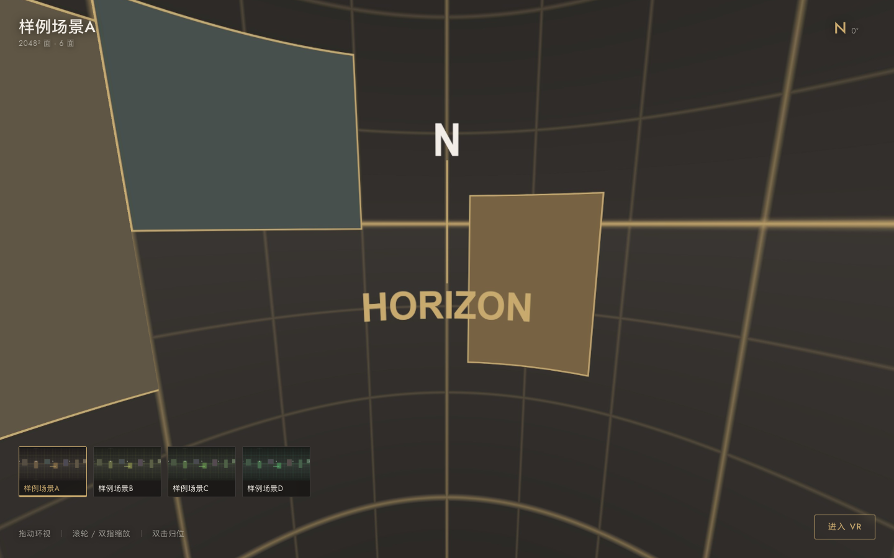

# 全景 VR 工具

把等距柱状全景图切成 6 个立方体面，用 Three.js 在浏览器里做成本地 VR 工具。
上传多张全景图 → 自动后台切片 → 一个项目一个链接 → 预览页里切换场景。

## 快速开始

需要 **Python 3.9+** 和 **Node.js 18+**（Node 只在跑自检时需要）。

```bash
pip install pillow numpy
python3 tools/server.py
```

浏览器打开 **http://127.0.0.1:8000/** ，把 `sample/sample-panorama.jpg`
拖进上传框，就能看到完整流程（这是一张程序生成的合成全景，不是实拍照片）。

| 页面 | 地址 | 用途 |
| --- | --- | --- |
| 管理页 | `/` | 上传、看切片进度、打开/删除项目 |
| 预览页 | `/p/<项目ID>` | 环视 + 场景切换 + VR，可发给别人 |
| 单场景 Demo | `/index.html` | 用仓库自带的合成全景，不含场景切换 |



上传后点「打开预览」，或把地址栏里的 `/p/xxxxxxxx` 复制给别人。
换端口用 `python3 tools/server.py --port 8001`。

> **仅监听本机。** 上传接口没有鉴权，等于一个任意文件写入的口子，
> 请不要暴露到公网。要给别人访问，必须同时补鉴权和 HTTPS。
>
> 也不要直接双击 HTML 文件打开 —— 浏览器禁止 `file://` 页面加载 ES 模块，会白屏。

## 用它做什么

1. **上传**：把全景图拖进虚线框（可多选）。
   同一次上传的图属于**同一个项目**，预览页里可以互相切换 —— 相当于"一套房"。
2. **等切片**：11008×5504 的图约 6 秒一张，进度条会实时走。
   这一步在后台跑，不用守着。
3. **打开预览**：点「打开预览」进 `/p/<id>`，底部出现场景切换条，
   点缩略图换房间。当前场景会写进 URL，刷新后还停在那个房间。
4. **分享**：把 `/p/<id>` 发出去即可，对方打开就是你此刻看到的这个项目。
5. **删除**：列表里点「删除」，会连同已切好的场景一起清掉。

只接受 **2:1** 的等距柱状全景图（RICOH THETA、Insta360 等导出的都符合）。
非 2:1 的图会被拒绝并告诉你原因，不会白切一遍。

## 操作方式

| 操作 | 效果 |
| --- | --- |
| 拖动 / 单指滑动 | 环视四周 |
| 滚轮 / 双指捏合 | 缩放（改变视场角，不会穿出全景盒） |
| 双击 | 回到初始朝向和默认缩放 |
| 方向键 / `+` `-` | 键盘环视与缩放（Tab 聚焦画面后可用） |
| 底部缩略图 | 切换场景 |
| 进入 VR | 连接 VR 设备后点击右下角按钮 |

右上角罗盘显示当前朝向读数，正前方为 `N / 0°`。

## 项目结构

```
.
├── docs/                    截图（预览页 / 管理页 / 单场景 Demo）
├── sample/                  合成示例全景图（程序生成，可重跑脚本复现）
├── LICENSE                  本项目 MIT 许可
├── .gitignore               排除 data/ 等运行产物
├── web/
│   ├── admin.html/js/css    管理页：上传、进度、项目列表、删除
│   ├── preview.html         预览页：/p/<id>
│   ├── preview.js/css       场景切换、从 URL 读项目
├── app.js                   Three.js 渲染器（预览页与旧 Demo 共用）
├── style.css                预览页基础样式
├── build_cubemap.py         切片算法（射线反投影）+ 命令行入口
├── tools/
│   ├── server.py            后端：上传、切片、项目 CRUD、静态服务
│   ├── make-sample-pano.py  生成合成示例全景图（不依赖任何实拍照片）
│   ├── check-seams.py       检查切面接缝（读真实 JPEG 像素）
│   ├── verify-logic.mjs     几何与代码一致性检查
│   ├── verify-controls.mjs  相机控制行为检查（真实 Three.js/OrbitControls）
│   ├── verify-render.mjs    Three.js 建场、着色器、贴图朝向检查
│   ├── verify-fov.mjs       视场角换算检查（保证各屏幕都能看全）
│   ├── verify-switch.mjs    场景切换检查（真实执行 loadScene）
│   ├── lib/stubs.mjs        测试用的 DOM/WebGL 桩（两个 verify 共用）
│   ├── verify-site.mjs      工具站前后端契约检查
│   └── run-checks.sh        一键跑全部检查
├── data/                    运行时生成：projects.json + 每个项目的切面
├── assets/cubemap/          旧的单场景 Demo 资源（仍可用）
└── vendor/three/            本地 Three.js（离线可用，不依赖 CDN）
```

`data/` 是运行时目录，可以整个删掉重来（会丢掉所有项目）。

## 切片是怎么做的

`build_cubemap.py` 用的是**射线反投影**，不是简单的透视拉伸：

对立方体每个面的每个输出像素，从立方体中心朝该像素方向发一条射线，
求出它与单位球的交点，再反算该点在全景图上的经纬度并采样：

```
面内坐标 (sx, sy) ∈ [-1, 1]
方向向量 d = u·sx + v·sy + n       （u/v/n 是该面的基向量，已归一化）
纬度 lat = asin(d.y)
经度 lon = atan2(d.x, d.z)
全景图像素：x = (lon / 2π + 0.5) · W
            y = (0.5 - lat / π) · H
```

两个细节保证接缝干净：

- **双线性插值**，且经度方向做**环绕采样**（左右边缘相接）、纬度方向做**钳制**（上下是极点）；
- 采样点取**像素中心**（`+0.5`），避免半像素偏移。

面顺序 `px, nx, py, ny, pz, nz`（即 `+X, -X, +Y, -Y, +Z, -Z`）与 Three.js
`BoxGeometry` 材质槽的顺序完全一致，所以 6 个贴图按下标一一对应即可。

#### 顶面和底面的朝向（很容易搞反）

四个侧面的 `v`（图像向上）都取世界 `+Y`，但顶面和底面不能这样，否则图片会
**上下颠倒 180°** —— 底面的表现最明显，看起来就是"地板上的图反了"。

原因：Three.js 的 `Texture` 默认 `flipY = true`，贴图上传时会上下翻转，
所以切面图像的"上方"必须对齐该面 `uv.y = 1` 的方向。实测 `BoxGeometry(1,1,1)`
六个面 `uv.y = 1` 的世界方向是：

| 面 | `uv.x=1` 方向 | `uv.y=1` 方向 | 所以 `u` | 所以 `v` |
| --- | --- | --- | --- | --- |
| `px` | `-Z` | `+Y` | `(0,0,-1)` | `(0,1,0)` |
| `nx` | `+Z` | `+Y` | `(0,0,1)` | `(0,1,0)` |
| `py` | `+X` | `-Z` | `(1,0,0)` | `(0,0,-1)` |
| `ny` | `+X` | `+Z` | `(1,0,0)` | `(0,0,1)` |
| `pz` | `+X` | `+Y` | `(1,0,0)` | `(0,1,0)` |
| `nz` | `-X` | `+Y` | `(-1,0,0)` | `(0,1,0)` |

注意 `py` 和 `ny` 的 `v` **符号相反**。`tools/verify-render.mjs` 会从真实的
`BoxGeometry` 反推这张表并逐面核对，改错了跑一下检查就会报出来。

### 不进网页，直接用命令行切片

`build_cubemap.py` 也能单独当脚本用（工具站的后端就是调它里面的函数）：

```bash
python3 build_cubemap.py ~/Pictures/主卧.jpg --name bedroom --size 2048
```

参数：

- `--name` 场景名（默认取文件名）
- `--size` 每个面的边长，默认 `2048`（桌面预览用 `1024` 更快）
- `-q` JPEG 质量，默认 `90`
- `-o` 输出目录，默认 `assets/cubemap`

结果会写进 `assets/cubemap/`，配合仓库里自带的 `/index.html` 单场景页面使用。
仓库里现在放的是 `sample/` 那张合成全景切出来的面。

## 配置

改 `tools/server.py` 顶部这几个常量即可：

| 常量 | 默认 | 说明 |
| --- | --- | --- |
| `FACE_SIZE` | `2048` | 每个面的边长。调大更清晰，但磁盘与显存占用是平方增长 |
| `JPEG_QUALITY` | `90` | 切面 JPEG 质量 |
| `MAX_UPLOAD_BYTES` | `120MB` | 单个文件上限 |
| `MAX_PIXELS` | 1.28 亿 | 像素总量上限（防解码后爆内存） |

> 为什么要有像素上限：`slice_faces()` 会把整张源图转成 float32 数组，
> 11008×5504 一张就要约 **0.68 GB**。两张并发切片就可能把内存吃光，
> 所以后端同一时间只切一张（`_slice_lock`）。

## 关于 VR

- WebXR 要求页面在 **https** 或 **localhost** 下运行，`127.0.0.1` 也算安全上下文。
- 桌面浏览器没接 VR 设备时，按钮会显示"未检测到 VR 设备"并置灰，这是正常行为。
- 头显里建议用局域网 IP 或部署到 https 访问；纯 http 的局域网 IP 浏览器会拒绝 XR。
- 进入 VR 后鼠标控制器会关闭，视角完全交给头显，避免两套输入打架。

## 实现要点

- **缩放改 FOV，不移动相机。** 相机固定在立方体中心，缩放只调整视场角，
  这样既不会穿出全景盒，也不会产生透视畸变。
- **初始视角略微向下看（pitch −10°）。** 相机在全景球心，`pitch=0` 是水平视线。
  实测房间数据：天花板下沿约在 `lat +14°`，而 `pitch=0` 配垂直 78° 视野时
  上边界到 `+39°`，**整整上三分之一都是吊顶** —— 这就是"视角太高"的量化原因。
  改成 −10° 后天花板占比从 32% 降到 19%，墙面主体落到画面中心。
  注意 OrbitControls 的几何是"相机停在 target 外侧"，所以**要让视线向下，相机反而要抬高**：
  `camera.y = -r*sin(pitch)`，符号写反会让视线朝上。
- **视场角用「水平」定义，不用垂直。** Three.js 的 `camera.fov` 是**垂直**视角，
  水平角度会被 `aspect` 放大 —— 同样一个垂直 75°，16:9 屏幕水平有 108°，
  而竖屏手机只有 **39°**（等于一条缝，这也是"看不全"的根因）。
  所以这里内部只维护一个水平视角 `hfov`（默认 110°），再按当前 `aspect`
  反算垂直 fov；`resize` 与横竖屏切换时都会重算，保证"一眼能看到多宽"在各种
  屏幕上一致。垂直方向另设 120° 上限，避免天花板/地板被拉伸成鱼眼。
- **每个面一张独立 `Texture`。** 注意 `CubeTexture` 只能在
  `scene.background` 或 `material.envMap` 下使用；把它当 `material.map` 用
  只会渲染出纯色，这是很容易踩的坑。
- **相机必须待在立方体中心。** OrbitControls 的工作方式是让相机绕 `target` 转，
  如果就让它把相机摆在半径 0.5 处，视线方向会歪、整幅全景看起来是斜的。
  这里让 OrbitControls 照常处理拖拽（保留它成熟的手感与阻尼），但每帧把相机位置
  **沿视线方向**缩回 `0.001` 的半径上 —— 方向完全不变，位置回到盒中心。
- **进入 VR 后必须停止干涉相机。** WebXR 每帧把头显姿态直接写进
  `camera.position` / `quaternion`，此时如果还在做上面的"收回中心"，就会和头显打架、
  把用户钉在原地、丢掉 6DoF。所以主循环在 `renderer.xr.isPresenting` 为真时跳过控制器。
- **场景切换条要等渲染器就绪。** `preview.js` 先于 `app.js` 执行，它一拿到项目数据
  就建切换条，但那时 `app.js` 还在加载 6 张贴图，`window.panoViewer` 尚未挂上 ——
  直接调用会抛 undefined。所以点击时先 `await waitForViewer()` 轮询等待。
- **静态路由千万别让 `web/` 遮蔽根目录。** 这是个把两个页面同时搞坏的坑：
  早先服务端把任意路径都先拿去 `web/` 下找，于是 `/style.css` 命中了
  `web/style.css`（**管理页**的样式表），根目录的查看器样式表永远拿不到 ——
  结果 `.hud` 规则全丢，HUD 消失；更隐蔽的是 `var(--strip)` 未定义导致
  场景切换条的 `bottom: calc(var(--strip) + 62px)` 整条声明失效，切换条被顶到
  画面外。所以现在 `web/` 下的文件必须走 `/web/` 前缀，根目录文件单独兜底。
- **官方 VR 按钮不能直接设 `display:none`。** `VRButton` 内部的
  `showEnterVR`/`showVRNotFound` 会执行 `button.style.display = ''`，
  把我们设的内联 `none` 清掉，于是 "VR NOT SUPPORTED" 会浮在画面正中。
  正确做法是把它塞进一个隐藏容器，按钮自身怎么改样式都影响不到容器。
- **⚠️ `BackSide` 会让画面左右镜像（最隐蔽的一个坑）。** 全景盒用的是
  `side: BackSide`（从盒子内部往外看），而 `BoxGeometry` 的 UV 是给"从外面看"
  设计的 —— 照抄它的 UV 方向，整幅全景就会左右翻转。实拍房间里几乎看不出来，
  但只要画面里有文字就会明确反着显示。正确做法是按"站在球心朝法线看时的右手边"
  取 `u = n × up`：`pz: u=-X`、`px: u=+Z`、`nx: u=-Z`、`nz: u=+X`。
  `tools/verify-render.mjs` 现在用**真实相机投影**验证"图像右侧确实落在屏幕右侧"，
  不再照抄 UV（照抄 UV 正是当初漏掉这个 bug 的原因）。
- **切换场景不能整屏变黑。** 早先用一个 `inset:0` 的近黑遮罩做"过渡"，
  而切一个场景要下载并解码 6 张 2048² 的图（几百毫秒到几秒），
  这期间**整屏全黑、连 HUD 一起盖住**，看起来就像崩了。现在改成：
  旧画面保持可见 + 顶部一条细进度线（进度是真实的，按 6 个面加载完成数），
  并且**先 `img.decode()` 再换上贴图**，切换是一步到位的原子操作。
  另外会顺手预热下一个场景的字节进 HTTP 缓存，往下切基本"秒开"。
- **`.scenes[hidden]` 必须显式写。** UA 样式表里 `[hidden]{display:none}` 的优先级是
  `(0,1,0)`，和 `.scenes{display:flex}` 相同，而作者样式表会覆盖 UA 样式表 ——
  结果 `hidden` 属性失效，单场景项目也会冒出一条空条。
- **切换场景不重建 `WebGLRenderer`。** 重建会闪黑、丢 WebGL 上下文、VR 会话也会断。
  换场景只改 6 个 `Texture` 的 `image` 再置 `needsUpdate`；而且必须**等 6 张图
  全部 decode 完再一起换上**，否则会看到 6 个面陆续刷新（明显的马赛克感）。
- **切片放后台线程 + 前端轮询。** 11008×5504 一张要切约 6 秒，同步响应必然超时。
  上传接口立刻返回 `jobId`，切片在后台跑，前端轮询 `/api/jobs/<id>` 显示进度。
- **上传先校验再落盘。** 非 2:1 的图直接在解析阶段拒掉并说明原因，
  不然会白切一遍（还占了几百 MB 内存）。
- **加载有真实进度。** `CubeTextureLoader` 不提供进度回调，所以这里用
  `Image` + `Promise` 自己数数，进度条反映的是真实加载比例。
- **键盘可达**，尊重 `prefers-reduced-motion`，移动端禁用了页面级双指缩放以免冲突。

## 自检

```bash
bash tools/run-checks.sh
```

共 259 项检查，分七部分：

1. **几何与代码一致性**（59 项）— 面基向量正交性、朝向无镜像、12 对相邻面公共边方向一致、
   面顺序与 `BoxGeometry` 槽位一致、`import` 与资源文件真实存在、DOM id 与 CSS 类名对得上、
   OrbitControls 用的是真实存在的 API、缩放钳制与 `preventDefault` 等交互细节、可访问性。
2. **相机控制行为**（17 项）— 用真实 Three.js 与 OrbitControls 跑：确认相机始终在盒中心、
   视线始终是单位向量、拖拽确实改变视角、`recenter` 不改变朝向、水平视角钳制在 40°–140°、
   俯仰不会越过天顶。
3. **Three.js 建场与着色器**（27 项）— 用 Node 加一个 WebGL 桩，实际跑通
   `WebGLRenderer` 初始化、6 个贴图构造、`renderer.render()`，确认着色器能编译、
   片元着色器确实采样了贴图；并**从 `BoxGeometry` 的真实 UV 反推每个面应有的基向量**，
   并**用真实相机投影**逐面确认图像右侧落在屏幕右侧、上方落在屏幕上方
   （防止左右镜像与上下颠倒）。
4. **切面接缝**（12 项）— 直接读切好的 JPEG，比较 12 对相邻面公共边的像素。
   目前最大平均色差 **4.05 / 255**（JPEG 压缩噪声量级），接缝无缝。
5. **视角与初始朝向**（39 项）— 用真实 `PerspectiveCamera` 验证 7 种屏幕比例下
   实际可见的水平/垂直角度；重点回归竖屏手机（修复前 39°，现在 77°）；
   回归初始俯仰角（含"符号写反导致视线朝上"这个坑）；并确认天花板不会占满上半屏。
6. **场景切换**（22 项）— 用 DOM/WebGL 桩真实跑 `app.js` 的 `loadScene`：
   断言 6 张贴图确实换成新场景、进度回调 0→1 共 6 次、切换期间再点会被挡住
   （不会并发换图）、加载失败会报错并释放锁（不会卡在"切换中"）。
7. **工具站契约**（83 项）— 前后端 DOM id 与 CSS 类名是否对得上、场景切换的关键约束
   （不重建 renderer、先 decode 再换）、路由路径一致性、目录穿越防护、
   上传校验、`pending` 状态是否会被清除、必需文件是否齐全。

> **关于验证方式的说明**：这台机器上的 Chrome 是 x64 版、通过 Rosetta 运行，
> 沙箱初始化会被系统拒绝，无头模式很不稳定（能截图，但跑带异步交互的页面经常挂住）。
> 所以验证分三层，各覆盖各的：
>
> 1. **静态画面** → 无头 Chrome 截图，人眼确认（`docs/` 里的三张图就是这么来的）。
>    这一步抓到过"整个 HUD 消失"这类纯样式问题。
> 2. **交互路径**（场景切换、相机控制）→ Node + DOM/WebGL 桩真实执行 `app.js`，
>    断言状态变化。比静态检查可靠得多。
> 3. **前后端流程** → 真实 HTTP 请求打完整条链路（上传真图 → 轮询进度 → 删除）。
>
> 换句话说：能截图的就截图看，要点击的在 Node 里把逻辑真跑一遍。

## 环境说明

工具本身**不依赖任何构建工具**，Three.js 已经放在 `vendor/`，完全离线可用，
不需要联网、也不需要 npm install。Python 侧只用到 `pillow` 和 `numpy`。

## 许可

本项目采用 MIT 许可，见 [LICENSE](LICENSE)。
内置的 Three.js 版权归 three.js authors 所有，同样遵循 MIT，见
[vendor/three/LICENSE](vendor/three/LICENSE)。

仓库里的示例全景由 `tools/make-sample-pano.py` 程序生成，不含任何实拍照片。
